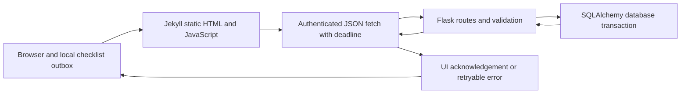

# Local PNEC communication and reliability

Prepared for #30, October 13, 2026. Documentation and code are AI-assisted
(OpenAI Codex); personal learning claims, Create code selection, videos and
reflections remain the student's responsibility.

## Request path

Locally the frontend origin is `http://127.0.0.1:4500` (4000 for the community
browser test); the usual Flask base is `http://127.0.0.1:8425`. Tests redirect API
calls to a disposable server, never the real resident DB. The static server does
not save data; JavaScript calls Flask. SQLAlchemy writes the account data.

| Browser operation | Method/endpoint | Ownership and storage |
| --- | --- | --- |
| Verify account | GET /api/auth/me | Cookie or opaque bearer token; no password/hash in response |
| Save profile | PATCH /api/auth/profile | Authenticated user's own validated fields |
| Read/save checklist/plan | GET/PATCH /api/preparedness | Own household record; PATCH merges item edits |
| Load quiz | GET /api/preparedness/quiz | Public question records |
| Submit quiz | POST /api/preparedness/quiz | Exact complete boolean keys; own saved answers |

Cookies use `credentials: include`; `_getAuthHeaders` includes the existing bearer
token when available. CORS must allow the frontend origin and credentials.
Authentication and permission checks occur at the backend; disabling buttons is
not authorization. Tokens in local/session storage are credentials and are never
included in test logs, screenshots or this document.

## Failure and recovery

`pnecJsonRequest` applies a 15-second AbortController deadline across fetch and
body reading. HTTP errors retain status/type; offline failures use a connection
message; a proxy's HTML error body produces a safe server message; malformed
successful JSON produces an unreadable-response error. It clears its deadline.
No write is automatically retried: a timeout can follow a committed write.

Checklist's existing item-level outbox stores pending items and edit versions in
browser localStorage. Failed saves leave them intact; reload merges pending
choices over fetched values, while unedited items come from the server. Explicit
Retry account save resends pending values. Older acknowledgements cannot clear
newer edits. Writes remain serialized; simultaneous devices are last-save-wins.
Browser storage must work for reload survival. Authentication unavailability
allows local checklist editing and explicit retry.

Profile failures retain the current form values and re-enable Save. They are not
persisted as a profile draft across reload/navigation; keep the page open and
retry, or use Cancel to discard. The task does not promise offline persistence
of every form. A failed household-plan/quiz submit likewise leaves its form open.

## Cloud deployment plan (not executed)

Existing READMEs describe GitHub Pages/static frontend, an EC2/nginx backend and
SQLite/MySQL choices; those descriptions are not current production verification.
A hostname resolves through DNS; HTTPS/TLS protects transport before nginx forwards
requests to Flask. Cloud hosting provides remote compute/storage and availability;
it does not remove Internet failures or automatically encrypt stored data.

Before any future deployment, verify approved frontend/backend origins, HTTPS
certificate/renewal and secure cookie configuration, CORS credentials behavior,
strong private configuration, intended database URI, persistent mounted storage,
backups/restore, permissions, health checks and monitoring. Use an organization
approved secrets manager/environment, never commit .env/tokens/database files.
Confirm intended production database and transaction behavior; SQLite and MySQL
can behave differently under concurrency. Check shared-worker rate limiting,
SMTP, live weather/chat providers, and organization adoption separately.

No deployment, cloud access, real mail, external chat/weather API, or real resident
submission was performed. Local HTTP tests do not verify production TLS or
at-rest encryption. Authentication does not imply encryption, and password hashing
is not reversible symmetric encryption.
