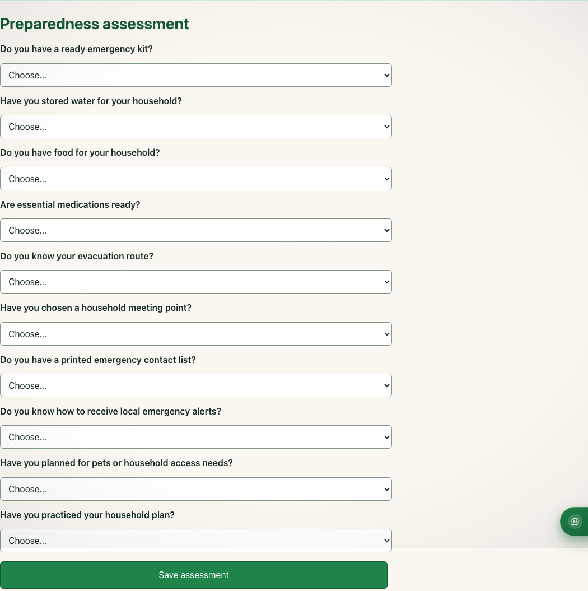
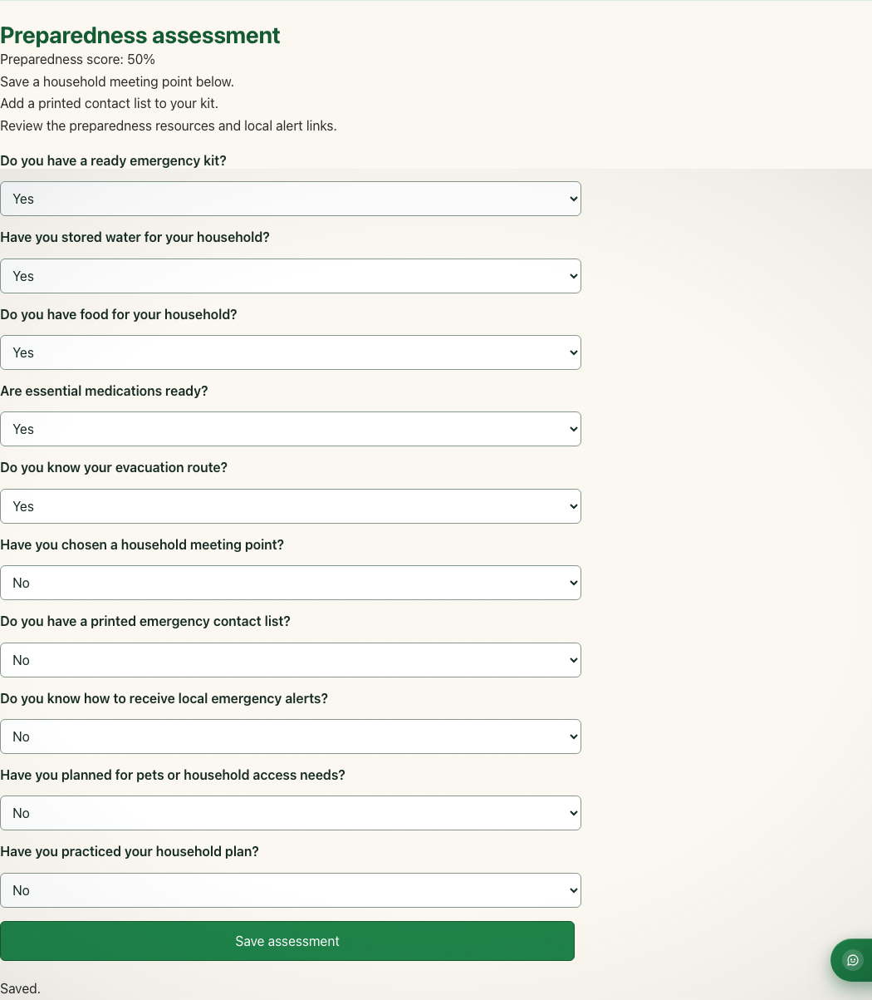
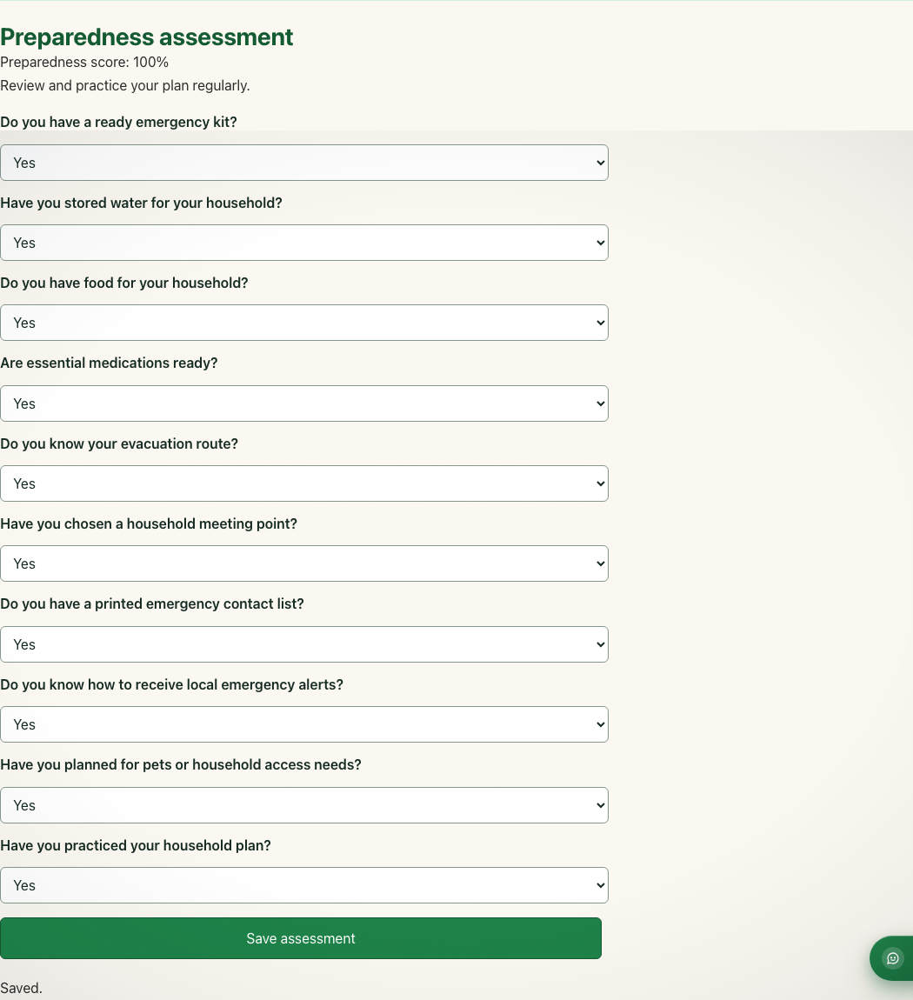
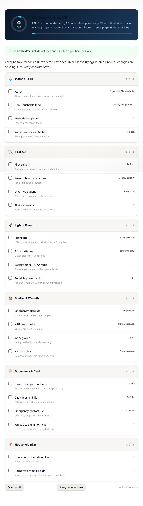
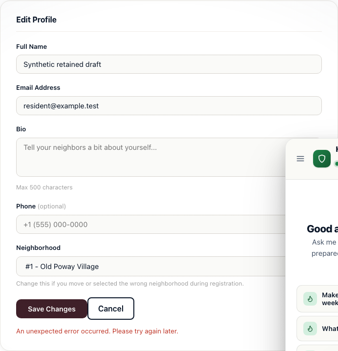
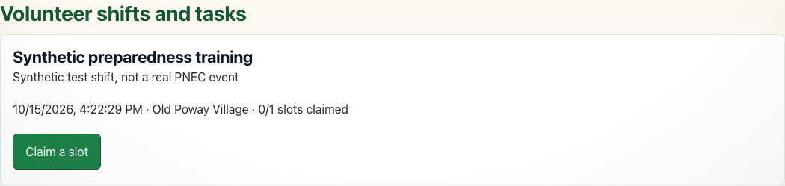
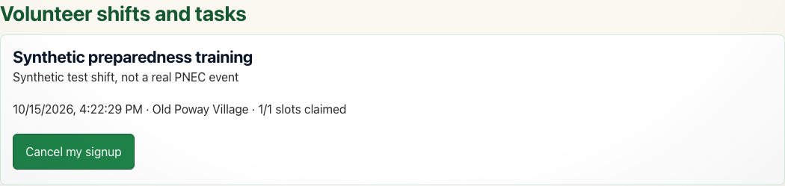
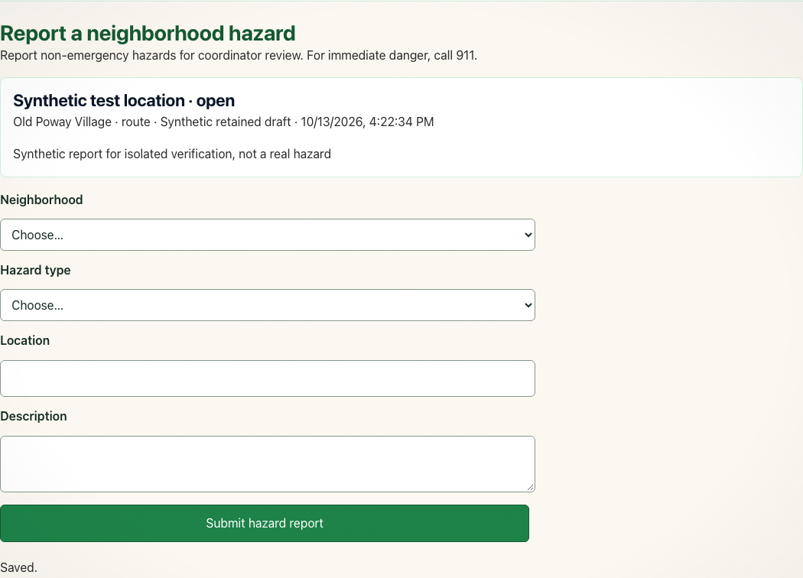
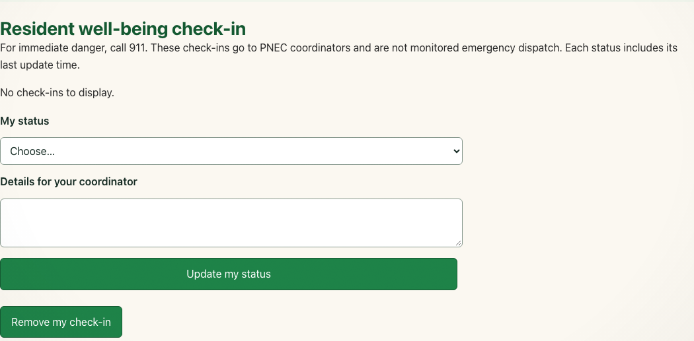
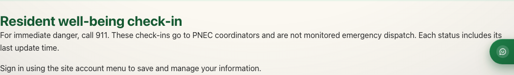

# Authentic local screenshot evidence

October 13, 2026; team-capstone. Captured with synthetic data and the code later committed as e33fc38. Failure screenshots are controlled local simulations, not production incidents. Shared-feature screenshots do not establish teammates’ personal authorship.

## quiz-interface.png

Ten-question quiz before answering, synthetic authenticated resident.

## quiz-0-of-10.png

Actual API result 0/10 = 0%, with returned recommendation text.

## quiz-5-of-10.png

Actual API result 5/10 = 50%, with returned recommendation text.

## quiz-10-of-10.png

Actual API result 10/10 = 100%, with returned recommendation text.

## checklist-persisted.png

Water remains checked after reload; isolated database value verified true.

## checklist-server-error.png

Simulated HTML 502: useful error shown and unchecked water retained locally; not a production incident.

## checklist-offline-pending.png

Simulated disconnected preparedness API after reload; pending water=false survives.

## checklist-recovered.png

Explicit Retry account save succeeds; isolated database now water=false.

## profile-failed-save-draft.png

Simulated profile HTML 502 preserves the current form draft and re-enables Save.

## volunteer-available.png

Existing shared volunteer UI: synthetic shift has 0/1 slots claimed.

## volunteer-signed-up.png

Existing shared signup behavior: synthetic resident claims the single slot.

## volunteer-cancelled.png

Existing shared cancellation behavior restores availability; no new Joan implementation.

## hazard-existing-metadata.png

Existing shared report display contains neighborhood/category/status/timestamp; filter controls and summary analysis are not implemented.

## checkin-other-resident-restricted.png

Existing authorization: another synthetic resident sees no check-ins; direct API returns an empty scoped list.

## checkin-login-required.png

Guest UI requires sign-in; separate direct unauthenticated API request returned 401.

